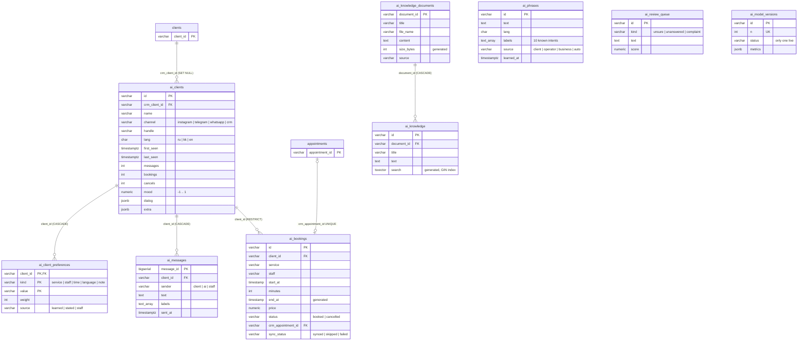

# VoroniX AI data: schema

The AI tables live in the CRM's PostgreSQL, inside the schema of each business (`t_<id>`), next to the CRM tables. Migrations: [`db/migrations`](../db/migrations) (`core/` once per database, `tenant/` once per business, tracked in `ai_migrations`).

## ERD

CRM tables are grey boxes; the AI tables link to them.



`ai_phrases`, `ai_review_queue`, `ai_events` and `ai_settings` have no foreign keys on purpose: training data and logs must outlive a deleted client card.

## Relationships

| Relationship | Type | Business rule | How it is stored |
|---|---|---|---|
| ai_clients – clients | M:1 | Several AI cards (one per messenger) can belong to one real CRM client | `ai_clients.crm_client_id`, found from `client_channels` |
| ai_clients – ai_client_preferences | 1:M | A client has many preferences, each kind + value once | composite PK `(client_id, kind, value)` |
| ai_clients – ai_messages | 1:M | Full chat history | FK, `ON DELETE CASCADE` |
| ai_clients – ai_bookings | 1:M | A booking always has a client; a client with bookings cannot be deleted | FK, `ON DELETE RESTRICT` |
| ai_bookings – appointments | 1:1 | Each AI booking is one CRM visit | `crm_appointment_id UNIQUE` |
| ai_knowledge_documents – ai_knowledge | 1:M | A document is cut into pieces; deleting it deletes them | FK, `ON DELETE CASCADE` |

## Views

| View | Purpose |
|---|---|
| `ai_calendar` | AI bookings + CRM visits the AI did not make, one calendar |
| `ai_knowledge_all` | AI knowledge + CRM `knowledge_entries`, one searchable list |
| `ai_client_card` | One line per client: CRM name and phone, usual service, master and time, staff notes |
| `ai_training_set` | Training phrases in the AI's `phrases.tsv` shape |

Example: which clients prefer evenings and who is their usual barber?

```sql
SELECT name, crm_phone, usual_service, usual_staff
FROM ai_client_card
WHERE usual_time = 'evening'
ORDER BY bookings DESC;
```

## Live changes

Every `ai_*` table and the CRM `appointments` table have an `AFTER` trigger that calls `public.ai_notify()`, which sends `{schema, col, id, op}` on the channel `ai_changes`. The server listens once and streams the changed rows to the AI pages watching that business.
